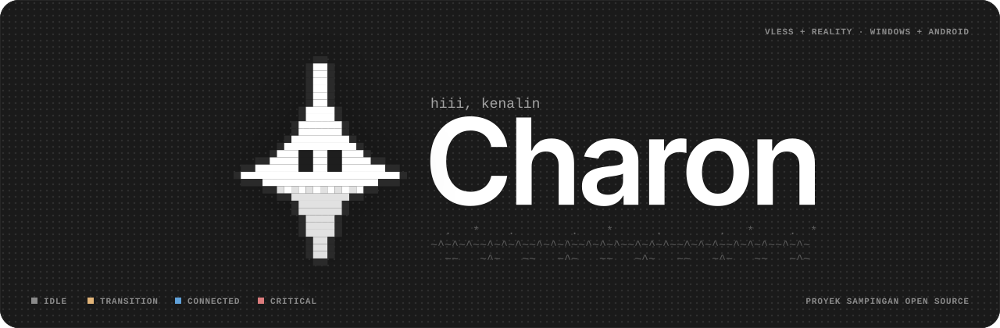

<div align="center">

[English](README.md) · **Bahasa Indonesia** · [简体中文](README.zh-CN.md)



<br>

**Client pribadi untuk server VLESS + Reality yang kamu jalankan sendiri. Xray di dalam. Flutter di atas.**

[](#status)


<br>

<table>
<tr>
<th align="center" width="25%">1 Protokol</th>
<th align="center" width="25%">2 Platform</th>
<th align="center" width="25%">0 Telemetri</th>
<th align="center" width="25%">3 Bahasa</th>
</tr>
<tr>
<td align="center" valign="top">Hanya VLESS + Reality<br><sub>Tidak ada yang lain di v1</sub></td>
<td align="center" valign="top">Windows dan Android<br><sub>Satu core Go bersama</sub></td>
<td align="center" valign="top">Tidak ada yang tidak kamu mulai<br><sub>Kecuali cek update</sub></td>
<td align="center" valign="top">EN, ID, dan 简体中文<br><sub>Tema terang dan gelap</sub></td>
</tr>
</table>

**[Apa itu](#apa-itu-charon) · [Bedanya](#satu-perbedaan-yang-penting) · [Fitur](#fitur) · [Desain](#bahasa-desain) · [Stack](#tech-stack) · [Struktur](#struktur-repositori) · [Build](#build) · [Tidak termasuk](#yang-tidak-dilakukan-charon) · [Lisensi](#lisensi)**

</div>

---

## Apa itu Charon

Charon terhubung ke server VLESS + Reality yang **kamu** jalankan sendiri. Itu saja tugasnya. Tidak ada akun, tidak ada server Charon, dan tidak ada yang dijual. Aplikasi ini menjalankan core Xray resmi, menunjukkan apa yang sedang dilakukan tunnel, dan menjaga traffic kamu supaya tidak diam-diam keluar dari tunnel saat ada yang rusak.

Ini proyek sampingan open source sekaligus portofolio, dibuat oleh satu mahasiswa yang ingin punya client yang mudah dipercaya dan mudah dipahami. Ini bukan layanan, bukan produk untuk dijual, dan tidak dimaksudkan untuk dibagikan sebagai produk.

## Status

> **Pre-alpha. Belum ada yang bisa dipakai.**
> Rebuild baru saja dimulai. Struktur folder sudah ada, arsitekturnya sudah ditulis, dan UI-nya sudah didesain. Kodenya menyusul.

## Satu perbedaan yang penting

Sebagian besar usaha desain tertuju pada satu momen: **proses tunnel mati saat kamu sedang terhubung.**

<table>
<tr>
<th width="50%">Tanpa traffic gate yang persisten</th>
<th width="50%">Charon</th>
</tr>
<tr>
<td valign="top">

> Tunnel putus. Aplikasi jatuh balik ke jaringan biasa. Tidak ada tanda apa pun di layar. Alamat aslimu dipakai sampai kamu sadar.

</td>
<td valign="top">

> Tunnel putus. Filter di level sistem menahan traffic. UI menampilkan **Blocked** dengan tiga aksi yang jelas: Coba lagi sekarang, Pilih server lain, Lepas.

</td>
</tr>
</table>

Di Windows, penahanan dilakukan oleh filter persisten milik sebuah service latar belakang kecil, jadi tetap bertahan walau jendela ditutup atau crash. Di Android, interface tunnel tetap menyala selama traffic ditahan. Disconnect manual tidak pernah memicu penahanan, karena itu pilihan yang kamu buat sendiri.

## Fitur

Semua yang ada di bawah ini adalah target desain untuk v1. Belum ada yang dirilis.

| Fitur | Fungsinya |
|---|---|
| **Traffic gate** | Tiga state: Disarmed, Armed, Held. Aktif hanya saat tunnel berhenti tanpa disengaja, termasuk saat adapter jaringan hilang |
| **Pemulihan yang bisa ditebak** | Sesi yang pernah Up mencoba ulang 5 kali per server, jeda 5 detik, lalu failover ke server berikutnya sesuai urutan daftar. Tidak pernah memutar balik dan tidak pernah pindah mundur sendiri |
| **Pelacakan kuota** | Dihitung per server di perangkatmu. Amber mulai 80 persen, merah saat mencapai batas. Saat batas tercapai Charon hanya menawarkan pindah dan tidak pernah memutus sendiri |
| **Split tunnel** | Aturan manual untuk domain dan rentang alamat, maksimal 1000 aturan per config |
| **Import** | Tempel link `vless://`, atau scan QR code di Android. Skema yang tidak didukung mendapat pesan yang jelas, bukan gagal diam-diam |
| **Sync terenkripsi** | Vault (Argon2id + AES-256-GCM) sebagai file `.charonvault` atau di server sync kecil yang kamu jalankan sendiri. Server tidak pernah melihat plaintext maupun passphrase kamu |
| **Update bertanda tangan** | Setiap rilis membawa manifest bertanda tangan Ed25519. Downgrade ditolak |
| **Diagnostik tersamarkan** | Hasil ekspor sudah bebas secret sejak dari rancangannya |
| **Bahasa dan tema** | Inggris, Bahasa Indonesia, Mandarin Sederhana. Terang dan gelap |

## Bahasa desain

Tenang secara default dan jujur soal apa yang dilakukannya. UI-nya monokrom, dan warna baru muncul saat status koneksi punya arti.

| | Prinsip | Dalam praktik |
|---|---|---|
| `01` | **Tenang secara default** | Permukaan abu-abu. Warna dipakai hanya saat membawa arti |
| `02` | **State yang jujur** | Setiap angka itu nyata. Fitur yang belum ada akan bilang belum ada, bukan dipalsukan |
| `03` | **Pixel untuk karakter** | Pixel art, ASCII, dan halftone membawa suasana. Status, angka, dan aksi tetap bersih dan mudah dibaca |
| `04` | **Ramah, tidak pernah kabur** | Maskot boleh tersenyum, tapi teksnya tetap tepat soal apa yang dilindungi dan apa yang tidak |


Biru artinya terhubung. Amber artinya ada yang sedang transisi. Merah hanya dipakai saat gate menahan traffic kamu atau alamat server diblokir, dan tidak untuk hal lain. Status tidak pernah mengandalkan warna saja: selalu ada label dan wajah maskot yang menyertainya.

Font yang dipakai **Inter** untuk teks bacaan dan **Space Mono** untuk label, angka, dan log. Keduanya berlisensi SIL Open Font License dan ikut dibundel di aplikasi. Permukaan dibuat lembut dan membulat, sedangkan apa pun yang berupa pixel atau ASCII tetap bersudut kotak.

## Tech Stack


Satu core bersama berbahasa Go memegang state machine koneksi sebagai fungsi murni, config builder, perhitungan kuota, dan pengecekan tanda tangan. Flutter hanya memegang UI dan client sync. Di Windows, sebuah service LocalSystem memegang tunnel dan Xray berjalan sebagai binary terpisah. Di Android, sebuah foreground service Kotlin menjalankan core Go lewat gomobile, dengan Xray di library yang sama. Pesan antara UI dan core memakai Protobuf.

## Struktur repositori

Rebuild ada di `v2/` selama client yang sekarang masih dipakai. Setelah rebuild siap, isinya pindah ke root repositori.

```
charon/
├── v2/
│   ├── core/                Modul Go: state machine, config builder, kuota, verifikasi
│   ├── platform/
│   │   ├── windows/         service, supervisor Xray, traffic gate, installer
│   │   └── android/         shell Kotlin (VpnService, notifikasi, tile) + binding gomobile
│   ├── app/                 UI Flutter dan client sync
│   ├── proto/               skema Protobuf, sumber tunggal untuk semua pesan
│   ├── scenarios/           file skenario bersama untuk tes, fake core, dan tes UI
│   └── server/charonsync/   server sync, satu binary Go
├── charon_vpn/              client Flutter yang sekarang (tetap ada sampai v2 menggantikan)
├── core/                    core Rust yang sekarang (sama)
└── sync-server/             server sync yang sekarang (sama)
```

## Build

Belum bisa di-build. Toolchain yang direncanakan: Go, Flutter dengan Dart, Android SDK dengan Kotlin, dan `protoc` untuk skema. Bagian ini akan diisi perintah sungguhan begitu sudah ada sesuatu yang bisa dijalankan.

## Yang tidak dilakukan Charon

- Tidak ada akun, tidak ada cloud, tidak ada server yang dijalankan Charon.
- Tidak ada langganan dan tidak ada pemilihan otomatis berdasarkan ping terendah.
- Tidak ada distribusi lewat store, setidaknya untuk sekarang.
- Tidak ada telemetri, analitik, atau upload crash. Satu-satunya panggilan jaringan yang tidak kamu mulai adalah cek update yang sudah didokumentasikan.
- Tidak ada protokol selain VLESS + Reality untuk v1.
- Tidak ada janji soal apa yang akan atau tidak akan diizinkan oleh jaringan mana pun. Charon adalah client untuk server yang kamu kelola. Seberapa baik hasilnya tergantung pada server dan jaringanmu.

## Lisensi

Aplikasinya berlisensi **GPL 3.0**. Xray core berlisensi **MPL 2.0** dan disertakan bersama lisensinya sendiri dan tautan ke source-nya. Di Windows ia berupa binary terpisah. Di Android ia tertanam di library aplikasi. Pemberitahuan pihak ketiga akan dicantumkan di aplikasi dan di repositori sebelum rilis pertama.

---

<p align="center"><code>~^~^~^~~^~^~^~~^~^~^~~^~^~^~~^~^~^~~^~</code><br><sub>Dibuat oleh <a href="https://github.com/hidnira-lab">@hidnira-lab</a>, satu penyeberangan jujur pada satu waktu. ^-^</sub></p>
