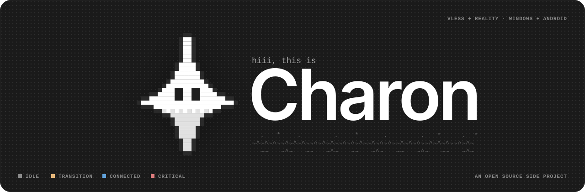

<div align="center">

**English** · [Bahasa Indonesia](README.id.md) · [简体中文](README.zh-CN.md)



<br>

**A personal client for the VLESS + Reality servers you run yourself. Xray inside. Flutter on top.**

[](#status)


<br>

<table>
<tr>
<th align="center" width="25%">0 Telemetry</th>
<th align="center" width="25%">1 Protocol</th>
<th align="center" width="25%">2 Platforms</th>
<th align="center" width="25%">3 Languages</th>
</tr>
<tr>
<td align="center" valign="top">Nothing you did not start<br><sub>Except the update check</sub></td>
<td align="center" valign="top">VLESS + Reality only<br><sub>Nothing else in v1</sub></td>
<td align="center" valign="top">Windows and Android<br><sub>One shared Go core</sub></td>
<td align="center" valign="top">EN, ID and 简体中文<br><sub>Light and dark themes</sub></td>
</tr>
</table>

**[What](#what-charon-is) · [Difference](#the-one-difference-that-matters) · [Features](#features) · [Design](#design-language) · [Stack](#tech-stack) · [Layout](#repository-layout) · [Build](#building) · [Not included](#what-charon-will-not-do) · [Licence](#licence)**

</div>

---

## What Charon is

Charon connects to a VLESS + Reality server that **you** already run. That is the whole job. There are no accounts, no Charon servers and nothing is sold. The app runs the official Xray core, shows you what the tunnel is doing, and keeps your traffic from quietly leaving the tunnel when something breaks.

It is an open source side project and a portfolio piece, written by one student who wanted a client that is easy to trust and easy to understand. It is not a service, not a product for sale, and not meant for distribution as one.

## Status

> **Pre-alpha. Nothing here is usable yet.**
> The rebuild has just started. The folder structure exists, the architecture is written down, and the UI is designed. The code comes next.

## The one difference that matters

Most of the design effort goes into one moment: **the tunnel process dies while you are connected.**

<table>
<tr>
<th width="50%">Without a persistent traffic gate</th>
<th width="50%">Charon</th>
</tr>
<tr>
<td valign="top">

> The tunnel drops. Apps fall back to the normal network. Nothing on screen tells you. Your real address is used until you notice.

</td>
<td valign="top">

> The tunnel drops. A system level filter holds the traffic. The UI shows **Blocked** with three clear actions: Retry now, Choose another server, Release.

</td>
</tr>
</table>

On Windows the hold is done by persistent filters owned by a small background service, so it survives the window closing or crashing. On Android the tunnel interface stays up while traffic is held. A manual Disconnect never triggers the hold, because that is a choice you made.

## Features

Everything below is the design target for v1. None of it is shipped yet.

| Feature | What it does |
|---|---|
| **Traffic gate** | Three states: Disarmed, Armed, Held. Engages only when the tunnel ends unexpectedly, including a vanished network adapter |
| **Predictable recovery** | A session that was up retries 5 times per server, 5 seconds apart, then moves to the next server in list order. Never wraps around, never moves back by itself |
| **Quota tracking** | Counted per server on your device. Amber from 80 percent, red at the cap. At the cap Charon only offers a move and never disconnects on its own |
| **Split tunnel** | Manual rules for domains and address ranges, up to 1000 rules per config |
| **Import** | Paste a `vless://` link, or scan a QR code on Android. Unsupported schemes get a plain message, not a silent failure |
| **Encrypted sync** | Vault (Argon2id + AES-256-GCM) as a `.charonvault` file or on a small sync server you run. The server never sees plaintext or your passphrase |
| **Signed updates** | Releases carry an Ed25519 signed manifest. Downgrades are refused |
| **Redacted diagnostics** | The export removes secrets by construction |
| **Languages and themes** | English, Bahasa Indonesia, Simplified Chinese. Light and dark |

## Design language

Calm by default and honest about what it does. The UI is monochrome, and colour only appears when a connection state means something.

| | Principle | In practice |
|---|---|---|
| `01` | **Calm by default** | Grey surfaces. Colour is used only when it carries meaning |
| `02` | **Honest states** | Every number is real. A feature that does not exist yet says so instead of faking it |
| `03` | **Pixel for personality** | Pixel art, ASCII and halftone carry the mood. Status, numbers and actions stay clean and readable |
| `04` | **Friendly, never vague** | The mascot can smile, but the copy stays precise about what is and is not protected |


Blue means connected. Amber means something is in transition. Red is reserved for the moment the gate holds your traffic or a server address is blocked, and for nothing else. Status never relies on colour alone: it always comes with a label and the mascot's face.

Type is **Inter** for reading and **Space Mono** for labels, numbers and logs, both under the SIL Open Font License and bundled with the app. Surfaces are soft and rounded, and anything pixel or ASCII keeps square corners.

## Tech Stack


One shared core in Go holds the connection state machine as a pure function, the config builder, quota accounting and signature checks. Flutter holds only the UI and the sync client. On Windows a LocalSystem service owns the tunnel and Xray runs as a separate binary. On Android a Kotlin foreground service hosts the Go core through gomobile, with Xray in the same library. Messages between UI and core are Protobuf.

## Repository layout

The rebuild lives in `v2/` while the current client keeps running. When the rebuild is ready it moves to the repository root.

```
charon/
├── v2/
│   ├── core/                Go module: state machine, config builder, quota, verification
│   ├── platform/
│   │   ├── windows/         service, Xray supervisor, traffic gate, installer
│   │   └── android/         Kotlin shell (VpnService, notification, tile) + gomobile bindings
│   ├── app/                 Flutter UI and the sync client
│   ├── proto/               Protobuf schema, the single source for all messages
│   ├── scenarios/           shared scenario files that drive tests, fake core and UI tests
│   └── server/charonsync/   the sync server, one Go binary
├── charon_vpn/              current Flutter client (stays until v2 replaces it)
├── core/                    current Rust core (same)
└── sync-server/             current sync server (same)
```

## Building

Not buildable yet. The planned toolchain is Go, Flutter with Dart, the Android SDK with Kotlin, and `protoc` for the schema. This section gets real commands as soon as there is something that runs.

## What Charon will not do

- No accounts, no cloud, no Charon-run servers.
- No subscriptions and no automatic lowest ping selection.
- No store distribution, at least for now.
- No telemetry, analytics or crash upload. The only network call that you did not start is the documented update check.
- No protocols other than VLESS + Reality for v1.
- No promises about what any network will or will not allow. Charon is a client for servers you operate. How well that works is down to your server and your network.

## Licence

The app is **GPL 3.0**. Xray core is **MPL 2.0** and ships with its own licence and a link to its source. On Windows it is a separate binary. On Android it is embedded in the app library. Third party notices will be listed in the app and in the repository before the first release.

---

<p align="center"><code>~^~^~^~~^~^~^~~^~^~^~~^~^~^~~^~^~^~~^~</code><br><sub>Built by <a href="https://github.com/hidnira-lab">@hidnira-lab</a>, one honest crossing at a time. ^-^</sub></p>
