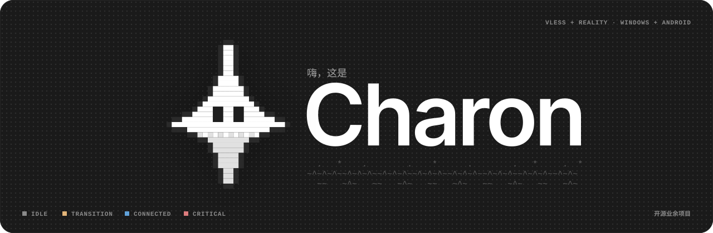

<!-- Chinese copy still needs a native speaker review (verification item V15 in the architecture master). -->
<div align="center">

[English](README.md) · [Bahasa Indonesia](README.id.md) · **简体中文**



<br>

**一个给你自己搭建的 VLESS + Reality 服务器使用的个人客户端。内核是 Xray，界面是 Flutter。**

[](#项目状态)


<br>

<table>
<tr>
<th align="center" width="25%">0 遥测</th>
<th align="center" width="25%">1 个协议</th>
<th align="center" width="25%">2 个平台</th>
<th align="center" width="25%">3 种语言</th>
</tr>
<tr>
<td align="center" valign="top">没有你没发起的请求<br><sub>更新检查除外</sub></td>
<td align="center" valign="top">仅限 VLESS + Reality<br><sub>v1 不支持其他协议</sub></td>
<td align="center" valign="top">Windows 和 Android<br><sub>共用一个 Go 内核</sub></td>
<td align="center" valign="top">EN、ID 和简体中文<br><sub>浅色和深色主题</sub></td>
</tr>
</table>

**[简介](#charon-是什么) · [区别](#最重要的一点区别) · [功能](#功能) · [设计](#设计语言) · [技术栈](#技术栈) · [目录结构](#仓库结构) · [构建](#构建) · [不包含](#charon-不会做什么) · [许可证](#许可证)**

</div>

---

## Charon 是什么

Charon 连接到**你自己**运行的 VLESS + Reality 服务器，这就是它的全部工作。没有账号，没有 Charon 的服务器，也不出售任何东西。应用内置官方 Xray 内核，让你看到隧道正在做什么，并在出问题时防止你的流量悄悄离开隧道。

这是一个开源业余项目，也是一份作品集，由一名学生开发，目标是做出一个容易信任、也容易理解的客户端。它不是服务，不是用来出售的产品，也不打算作为产品对外分发。

## 项目状态

> **Pre-alpha（早期阶段），目前还不能使用。**
> 重建刚刚开始。目录结构已经建好，架构已经写成文档，界面也已设计完成。接下来是代码。

## 最重要的一点区别

大部分设计精力都花在一个时刻上：**你正在连接时，隧道进程挂掉了。**

<table>
<tr>
<th width="50%">没有持久流量闸门时</th>
<th width="50%">Charon</th>
</tr>
<tr>
<td valign="top">

> 隧道断开。应用回退到普通网络。屏幕上没有任何提示。你的真实地址会一直被使用，直到你发现为止。

</td>
<td valign="top">

> 隧道断开。系统级过滤器会拦住流量。界面显示 **Blocked**，并给出三个明确的操作：立即重试、选择其他服务器、释放。

</td>
</tr>
</table>

在 Windows 上，拦截由一个小型后台服务所拥有的持久过滤器完成，所以即使窗口关闭或崩溃，它也会继续生效。在 Android 上，拦截期间隧道接口保持开启。手动断开连接永远不会触发拦截，因为那是你自己做出的选择。

## 功能

以下全部是 v1 的设计目标，目前都还没有发布。

| 功能 | 说明 |
|---|---|
| **流量闸门（断网保护）** | 三种状态：Disarmed、Armed、Held。只在隧道意外结束时才启用，包括网络适配器消失的情况 |
| **可预期的恢复** | 曾经连通过的会话，在每台服务器上重试 5 次，每次间隔 5 秒，然后按列表顺序故障转移到下一台服务器。不会循环回头，也不会自己退回到之前的服务器 |
| **流量额度统计** | 按服务器在你的设备上统计。达到 80% 时变为琥珀色，到达上限时变为红色。到达上限时，Charon 只会提示你切换，绝不会自己断开连接 |
| **分流规则** | 手动设置域名和地址段规则，每个配置最多 1000 条规则 |
| **导入** | 粘贴 `vless://` 链接，或在 Android 上扫描二维码。不支持的协议链接会得到清楚的提示，而不是悄悄失败 |
| **加密同步** | 保险库（Argon2id + AES-256-GCM）可保存为 `.charonvault` 文件，也可放在你自己运行的小型同步服务器上。服务器永远看不到明文，也看不到你的口令 |
| **签名更新** | 每个发布版本都带有 Ed25519 签名的清单。拒绝降级 |
| **脱敏诊断** | 导出的内容在设计上就已经去除了敏感信息 |
| **语言和主题** | 英语、印度尼西亚语、简体中文。浅色和深色 |

## 设计语言

默认保持平静，并对自己做的事情保持诚实。界面是单色的，只有当连接状态有意义时才会出现颜色。

| | 原则 | 实际做法 |
|---|---|---|
| `01` | **默认保持平静** | 灰色表面。只在颜色承载含义时才使用颜色 |
| `02` | **诚实的状态** | 每个数字都是真实的。还不存在的功能会直接说明，而不是伪造 |
| `03` | **用像素表达个性** | 像素画、ASCII 和半色调负责氛围。状态、数字和操作保持清晰易读 |
| `04` | **友好，但不含糊** | 吉祥物可以微笑，但文案对“哪些受到保护、哪些没有”始终保持精确 |


蓝色表示已连接。琥珀色表示正在过渡。红色只保留给闸门拦住你的流量，或服务器地址被封锁的时刻，不用于其他任何情况。状态从不只靠颜色来表达：总是同时带有文字标签和吉祥物的表情。

字体方面，**Inter** 用于阅读，**Space Mono** 用于标签、数字和日志，两者均采用 SIL 开源字体许可证，并随应用一起打包。表面柔和圆润，凡是像素或 ASCII 内容都保持直角。

## 技术栈


一个用 Go 写的共享内核，以纯函数的形式持有连接状态机，并负责配置生成、额度统计和签名校验。Flutter 只负责界面和同步客户端。在 Windows 上，一个 LocalSystem 服务拥有隧道，Xray 作为独立的二进制文件运行。在 Android 上，一个 Kotlin 前台服务通过 gomobile 承载 Go 内核，Xray 位于同一个库中。界面与内核之间的消息使用 Protobuf。

## 仓库结构

重建工作放在 `v2/` 中，目前使用的客户端继续运行。重建完成后，内容会移到仓库根目录。

```
charon/
├── v2/
│   ├── core/                Go 模块：状态机、配置生成、额度、校验
│   ├── platform/
│   │   ├── windows/         服务、Xray 监督器、流量闸门、安装程序
│   │   └── android/         Kotlin 外壳（VpnService、通知、快捷图块）+ gomobile 绑定
│   ├── app/                 Flutter 界面和同步客户端
│   ├── proto/               Protobuf 协议定义，所有消息的唯一来源
│   ├── scenarios/           共用的场景文件，驱动测试、模拟内核和界面测试
│   └── server/charonsync/   同步服务器，一个 Go 二进制文件
├── charon_vpn/              当前的 Flutter 客户端（在 v2 取代它之前保留）
├── core/                    当前的 Rust 内核（同上）
└── sync-server/             当前的同步服务器（同上）
```

## 构建

目前还不能构建。计划使用的工具链是 Go、Flutter 和 Dart、带 Kotlin 的 Android SDK，以及用于处理协议定义的 `protoc`。等有了可以运行的东西，这一节会补上真实的命令。

## Charon 不会做什么

- 没有账号，没有云端，没有由 Charon 运营的服务器。
- 没有订阅，也没有自动选择最低延迟的服务器。
- 暂时不通过应用商店分发。
- 没有遥测、统计分析或崩溃上传。唯一一个你没有发起的网络请求，是有文档说明的更新检查。
- v1 只支持 VLESS + Reality，不支持其他协议。
- 不对任何网络允许或不允许什么做出承诺。Charon 只是用来连接你自己运营的服务器的客户端，效果好坏取决于你的服务器和你的网络。

## 许可证

本应用采用 **GPL 3.0**。Xray 内核采用 **MPL 2.0**，并附带它自己的许可证和源代码链接。在 Windows 上它是独立的二进制文件，在 Android 上它内嵌在应用库中。第一次发布之前，第三方声明会列在应用内和仓库里。

---

<p align="center"><code>~^~^~^~~^~^~^~~^~^~^~~^~^~^~~^~^~^~~^~</code><br><sub>由 <a href="https://github.com/hidnira-lab">@hidnira-lab</a> 制作，一次一段诚实的摆渡。^-^</sub></p>
